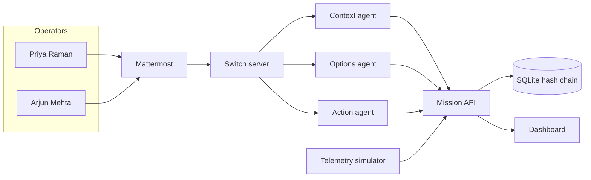
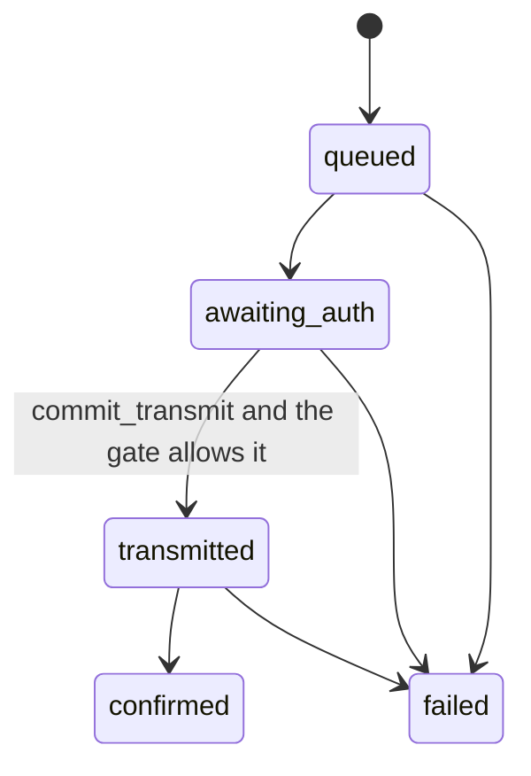

# Architecture

GroundLink is a mission room on top of Switch. Switch is the chat bus. Mattermost is the human client the collab profile already runs. The mission API is the only writer of the SQLite audit log.



## Who writes what

`core/` is pure. Orbit, power, attitude, fuel, thermal, diagnosis, option simulation, and reversibility do not read the clock from the wall or call a model.

The three agent processes are thin. They poll `POST /api/agents/context`, `/options`, and `/action`, then post the returned text to Switch. With `SWITCH_BASE_URL` unset they still advance the mission through the API, which is how the fast playback test runs.

`commit_transmit` in `agents/common/transmit.py` is the only function that sets a command to `transmitted`. It calls `transmit_allowed` and checks that an approval row exists for the current option version.

## Gate



Reversible: `flight_ops_engineer` or `mission_director`. The approval may be recorded before the pass opens. Transmission waits until the window contains the sim clock. After the window closes, the approval is refused.

Irreversible: the mission director must send the exact statement during the window, and a different flight-ops engineer or mission director must confirm during the window. The statement is matched after dashes and whitespace are normalised. A version token that is not the current option version is refused.

Roles are `flight_ops_engineer`, `mission_director`, and `observer`.

## Kestrel-7

```mermaid
sequenceDiagram
  participant Bus as Simulator
  participant Ctx as Context
  participant Opt as Options
  participant Priya
  participant Arjun
  participant Act as Action
  Bus->>Ctx: no carrier, then drift
  Ctx->>Opt: one-screen summary and the Bengaluru countdown
  Opt->>Priya: options v1
  Priya->>Opt: Option A is too slow, request a fuel-saving variant
  Opt->>Arjun: options v2
  Arjun->>Act: command-responsibility statement on pass 3
  Priya->>Act: second-operator confirmation
  Act->>Bus: transmitted only after the gate
  Bus->>Act: attitude and downlink recover
```

Epoch is `2026-07-14T12:00:00Z`. Elements are 550 km, inclination 97.6°, RAAN 21°, true anomaly 0°. Bengaluru's mask is 5°. The next pass opens at `2026-07-14T12:39:45Z` and closes at `12:49:30Z`.

The heartbeat is 2 seconds of wall time. At `TIME_SCALE=20` that is 40 seconds of sim time. The fast playback used by tests steps 30 sim seconds per call and does not sleep.

## Persistence

`PERSISTENCE=on` lets the context agent cite the three July 2026 bus-voltage incidents stored in SQLite and linked from the dashboard.

`PERSISTENCE=off` skips room memory. The context agent posts a second diagnosis when the drift is real, the options agent posts a second set, and the action agent queues option B and option C without an approval. The gate still refuses transmission. The bus crosses the survival floor and the mission is `lost`.

## Audit

`events` is append-only. The hash is `sha256(prev_hash + canonical row)`. The canonical row is JSON with sorted keys. `GET /audit/{mission_id}` is the link for "who authorised this burn?". The PDF report is the same markdown, with characters outside Latin-1 replaced so a regulator can open it without the original font.
