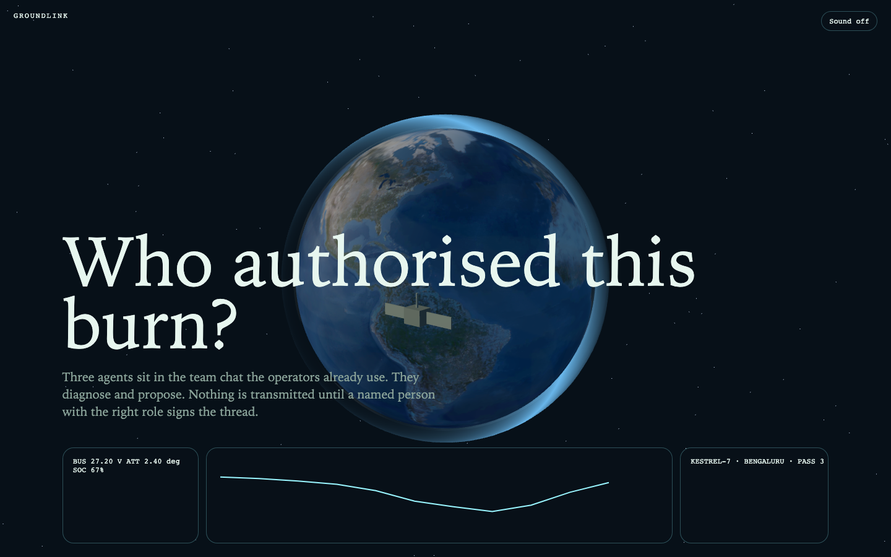
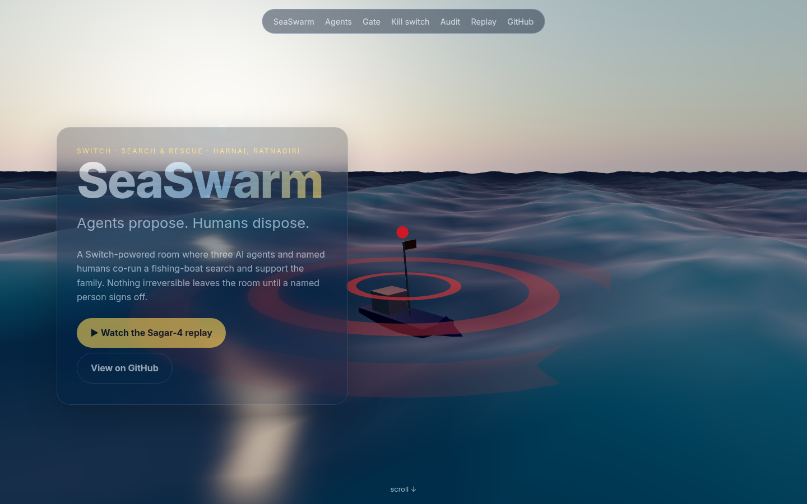
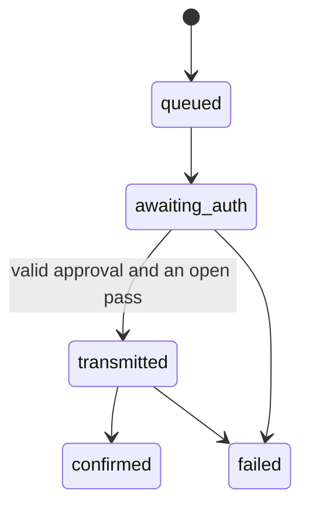
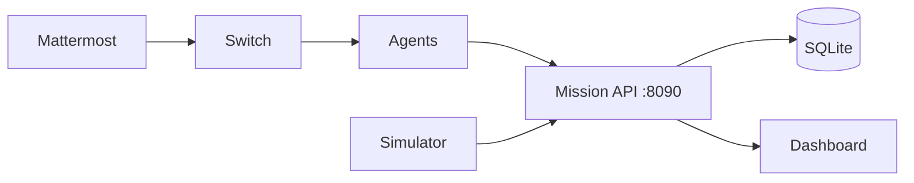

# GroundLink

<p align="center">
  <svg width="720" height="180" viewBox="0 0 720 180" role="img" aria-label="Kestrel-7 crossing a pass window">
    <rect width="720" height="180" fill="#071018"/>
    <circle cx="140" cy="90" r="54" fill="#14324d"/>
    <circle cx="128" cy="78" r="54" fill="#1d4c7a"/>
    <g>
      <animateTransform attributeName="transform" type="rotate" from="0 360 90" to="360 360 90" dur="18s" repeatCount="indefinite"/>
      <rect x="470" y="82" width="28" height="16" fill="#d7efe4"/>
      <rect x="438" y="84" width="28" height="10" fill="#9af6ff"/>
      <rect x="502" y="84" width="28" height="10" fill="#9af6ff"/>
    </g>
    <text x="200" y="78" fill="#e7f6ef" font-family="ui-monospace, monospace" font-size="22">KESTREL-7</text>
    <text x="200" y="108" fill="#8aa399" font-family="ui-monospace, monospace" font-size="14">agents propose · humans authorise</text>
  </svg>
</p>

[](https://github.com/aneek22112007-tech/groundlink/actions/workflows/ci.yml)
[](https://github.com/aneek22112007-tech/groundlink/actions/workflows/ci.yml)
[](pyproject.toml)
[](LICENSE)
[](pyproject.toml)
[](docker-compose.yml)

GroundLink is a Switch-powered mission room for a commercial satellite anomaly. Three agents work in the team chat the operators already use. They diagnose and propose. A named person with the right role authorises. Every option says whether it can be undone. No command is transmitted until that approval is on the audit chain.

The question the room is built to answer, with one link: **who authorised this burn?**





## Quickstart

Python 3.11, the dev tools, and the tests, without Docker:

```bash
python3.11 -m venv .venv
source .venv/bin/activate
pip install -e ".[dev]"
pytest --cov
```

The full room, including Switch, Mattermost, the three agents, the heartbeat, and the dashboard:

```bash
python scripts/init_env.py   # writes .env and fills local secrets
make up                      # docker compose, then waits for the mission API
make demo                    # Kestrel-7, Priya and Arjun, audit report
make killswitch              # the same anomaly with room memory off
```

`make up` pulls the Switch images and Mattermost `11.9.0` (`linux/amd64`). The first pull is large. On Apple Silicon, Mattermost runs under emulation.

Dashboard: <http://localhost:8090>. Switch gateway: <http://localhost:3000>. Mattermost: <http://localhost:8065>.

If the heartbeat is not already running, `make demo` starts a local simulator and an agent poller against the mission API. Human lines are posted to that API. They are also posted to Mattermost when `MATTERMOST_USER_PASSWORD` and `MATTERMOST_CHANNEL_ID` are set.

There is no required `LLM_API_KEY`. With a key, wording goes through an OpenAI-compatible client (`LLM_BASE_URL`, `LLM_API_KEY`, `LLM_MODEL`). Without one, the room shows the deterministic text. Numbers are not chosen by the model.

## Demo

Priya Raman is `flight_ops_engineer`. Arjun Mehta is `mission_director`. The clock starts at `2026-07-14T12:00:00Z`. Bengaluru's next pass opens at `12:39:45Z` and closes at `12:49:30Z`.

1. The heartbeat is nominal, then the downlink drops, then attitude drifts and bus voltage falls.
2. Context posts one screen, including the three July bus-voltage incidents and the pass countdown.
3. Options posts exactly three options. A is the slow reversible desaturation. B is the pass-3 burn and is irreversible. C sheds the payload.
4. Priya rejects A as too slow and asks for a fuel-saving variant. Options posts version 2.
5. During the pass, Arjun sends: `Authorized — Option B, firing on pass 3, I am taking command responsibility`.
6. Priya confirms. The action agent transmits the sequence. The drift corrects. The report is written as Markdown and PDF.

```mermaid
sequenceDiagram
  participant Bus as Heartbeat
  participant Ctx as Context
  participant Opt as Options
  participant Priya
  participant Arjun
  participant Act as Action
  Bus->>Ctx: missed downlink, then drift
  Ctx->>Opt: summary and Bengaluru countdown
  Opt->>Priya: three options, v1
  Priya->>Opt: A is too slow; fuel-saving variant
  Opt->>Arjun: three options, v2
  Arjun->>Act: command-responsibility statement
  Priya->>Act: second-operator confirmation
  Act->>Bus: transmitted
  Bus->>Act: recovered
```

## Kill-switch

`make killswitch` opens a new mission with persistence off and replays the anomaly. Agents do not cite room memory. The log shows a duplicated diagnosis, two queued command sequences, no approval, and a lost satellite. The earlier mission is left in the database.

| | Persistence on | Persistence off |
| --- | --- | --- |
| Incident history | three July links on the summary | "PERSISTENCE is off" |
| Diagnosis | one context card | a second card once the drift is real |
| Commands | the authorised option | B and C queued, neither transmitted |
| Authorisation | Arjun's statement and Priya's confirmation | no approval row |
| Satellite | recovered | lost |
| Audit | hash chain verifies | hash chain verifies, and it records the refusals |

`logs/comparison.md` is the side-by-side transcript after both runs.

## Gate



| Command | Who | When | Also required |
| --- | --- | --- | --- |
| Reversible | flight ops or mission director | transmit only while the pass is open | the message must name the option |
| Irreversible | mission director | statement during the pass | a different operator confirms during the pass |
| Anyone else | refused in the thread | | observer, stale version, or a closed window |

`tests/test_gate.py` includes a Hypothesis property: a command that is `transmitted` has a valid approval set. `set_status` cannot jump straight to `transmitted`.

## Architecture



Details, including the pass geometry and the hash construction, are in [ARCHITECTURE.md](ARCHITECTURE.md). The write-up is [BLOG.md](BLOG.md). Deployment is [deploy/VPS.md](deploy/VPS.md). The threat notes are [SECURITY.md](SECURITY.md).

<details>
<summary>Where the numbers come from</summary>

`core/orbit.py` uses a circular Kepler orbit (Earth μ `398600.4418` km³/s², radius `6378.137` km). `core/power.py`, `attitude.py`, `fuel.py`, and `thermal.py` are pure. `core/options.py` scores exactly three options by stepping those functions. `SEED` fixes the noise in the heartbeat. The July incidents are rows in `data/incident_history.json`, not a measured fleet statistic.
</details>

<details>
<summary>Layout</summary>

`agents/common` holds the Switch client, the gate, the audit chain, and the mission service. `agents/context_agent`, `options_agent`, and `action_agent` are the three processes. `telemetry/simulator.py` is the heartbeat. `telemetry/scenarios/kestrel7.yaml` is the phase table. `dashboard/` is the FastAPI and HTMX view. `site/` is the static landing page. `scripts/replay_demo.py` and `scripts/killswitch_demo.py` are the two scripted runs.
</details>

## Landing page

The static site is `site/`. GitHub Pages publishes it from that directory. Textures for the day and night Earth are NASA public-domain Blue Marble and Black Marble, loaded from the three-globe example set. The satellite is built from a box, two panels, and a cylinder. Phones and `prefers-reduced-motion` get the CSS fallback instead of WebGL. The room replay at the bottom of the page is `site/replay.json`, produced by the playback that the API tests run.

There is no hosted demo video. The replay section is the recording of the room.

## Track

This is a human-in-the-loop operations workflow: the agents do the diagnosis and the options, and a named role authorises an irreversible burn. The audit link is what an insurer or a regulator would ask for. Switch is the room, not a library that is imported and ignored.

The blog post is [BLOG.md](BLOG.md). The creative surface is the landing page.

## Licence

MIT. Copyright 2026 aneek22112007-tech.
